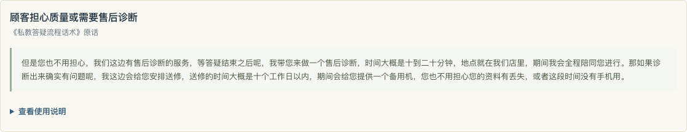
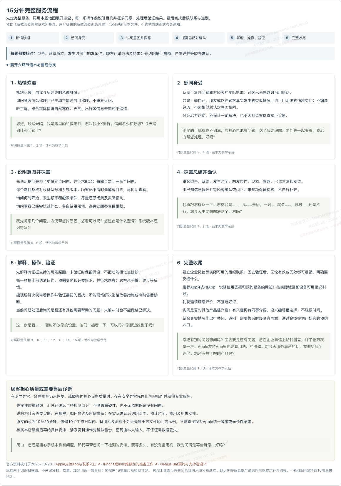
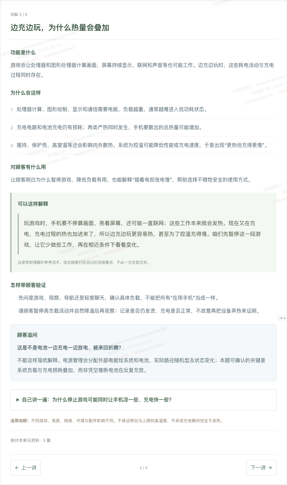
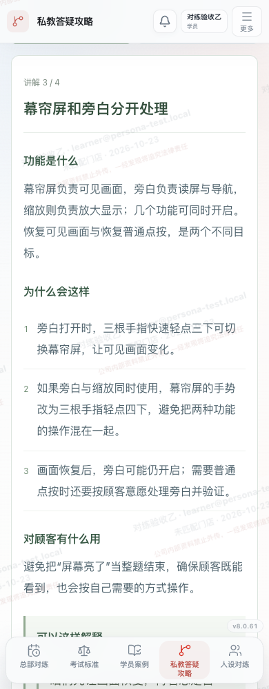
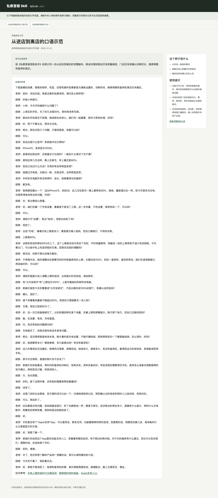
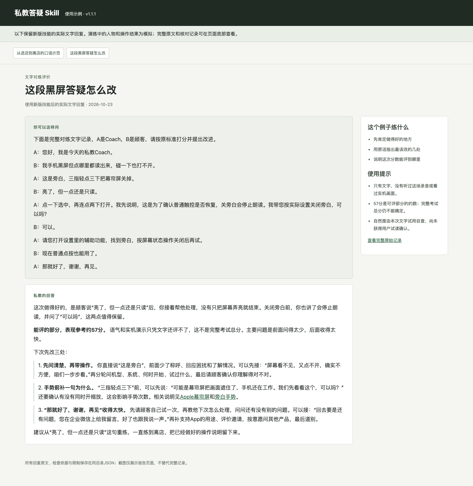
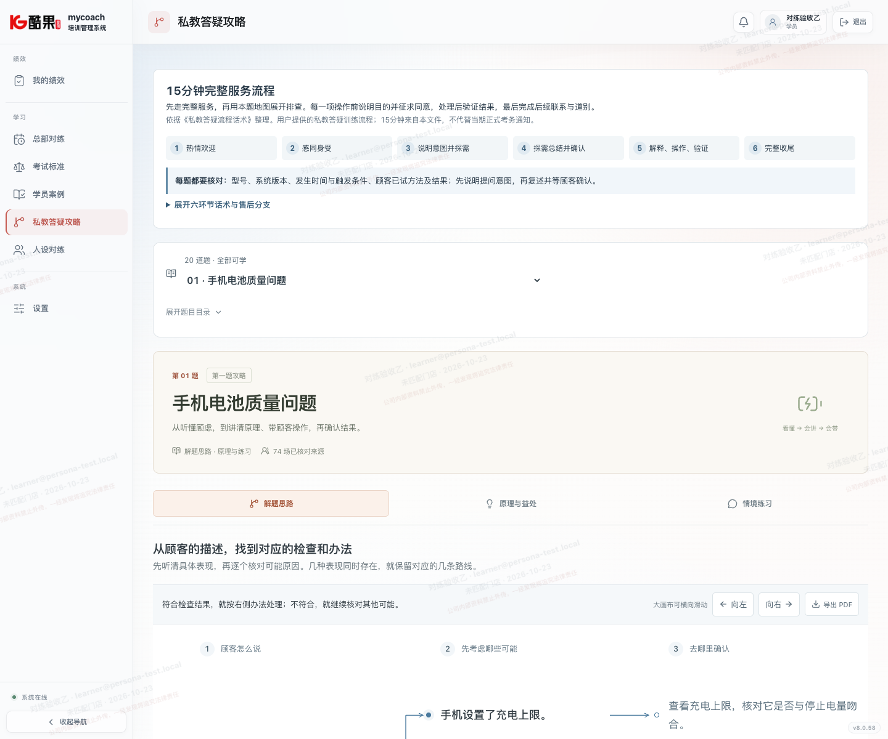

# 私教答疑 Skill

把现有考试资料整理成一个能答疑、陪练、评价对练记录的私教教练。支持Codex、WorkBuddy及能够加载完整Skill目录的AI。仓库已按资料所有者授权公开。

新版补全第2至20题的77个深入讲解单元：功能、因果原理、益处、通俗话术、操作验证、常见追问和口头自测。第一题沿用已认可内容。售后诊断话术直接使用《私教答疑流程话术》原话，供学员照着练习；其他交流方式继续参考过去考试记录。完整流程保留。

## 下载与安装

**[下载最新v1.2.0安装包](https://github.com/hebokenn/mycoach-qna-tutor/releases/tag/v1.2.0)**

- `mycoach-qna-tutor-v1.2.0.zip`：Codex及支持标准Skill目录的AI。
- `mycoach-qna-tutor-workbuddy-v1.2.0.zip`：WorkBuddy上传用。
- `SHA256SUMS`：下载校验值。

Codex：解压完整文件夹，放入个人`~/.agents/skills/`或项目的`.agents/skills/`。在新对话里输入`$mycoach-qna-tutor`。也可以从源码安装：

```bash
git clone https://github.com/hebokenn/mycoach-qna-tutor.git
cd mycoach-qna-tutor
python3 tools/install.py
```

更新已有安装并保留旧版时，运行`python3 tools/install.py --backup-existing`。安装工具默认不会覆盖现有目录。依据：[Codex官方技能说明](https://learn.chatgpt.com/docs/build-skills)。

WorkBuddy：在“专家·技能·连接器 → 技能 → 添加技能 → 上传技能”中导入带`workbuddy`的ZIP，并确认启用。依据：[WorkBuddy官方上传说明](https://www.codebuddy.cn/docs/workbuddy/From-Beginner-to-Expert-Guide/Function-Description/Skills-Market)。本次已验证打包、解压和独立运行；v1.2.0未在WorkBuddy应用内重新导入验收。

安装时保留整个目录里的资料、脚本和原量尺，不能只复制SKILL.md。

## 可以怎么用

- **考试答疑**：“考试主要考什么？我还有一周，每天能练30分钟，怎么准备？”
- **你当Coach，AI当顾客**：“随机抽一道题。你当顾客，我当Coach，先别告诉我答案。”
- **AI当Coach，你当顾客**：“我手机黑屏，还会读出声音。你一步步带我查，等我反馈再继续。”
- **评价已有记录**：“这是我和同事的完整对练记录。请按考试标准评价，告诉我哪里做得好、最该改哪几处。”

对练时说“暂停”可以要提示，说“结束”可以复盘。以一场真实人设作背景逐步披露；默认模拟会补齐必要界面并口述数字、选项和操作变化，新增内容单独记为模拟。要求“严格历史回放”才只按原记录、未知保持未知。保留本机v1.1.3的顾客情绪、屏幕口述和本轮系统版本规则。语音对练取决于宿主是否已有语音会话能力；本包不附电话拨号或语音引擎。

评分默认用中文直接讲表现、引用原话、给具体改法。能完整评价时给一个总分；只收到片段或缺少声音、画面时会说明哪些还不能评，不把缺证据当作零分。想看细项可以说“逐项说明”，想核对计算再要求详细算式。

更多示例见[使用说明](docs/usage.md)。

## 完整服务流程

欢迎与称呼 → 感同身受 → 说明意图并探需 → 复述确认 → 解释、操作与验证 → 完整收尾。

每题都核对型号、系统、发生时间和条件，以及顾客已经试过什么。每项操作前说清目的并征求同意。处理后问其他问题，安排企微反馈、支持App、评价与按意愿交接，最后道别。15分钟来自用户提供的训练文件，正式考务仍看当期通知。

售后诊断这一段按资料原话展示，学员可直接照着练习；使用说明收在折叠项内。



[查看流程与原稿](skills/mycoach-qna-tutor/references/service-flow.md) · [口头表达参考](skills/mycoach-qna-tutor/references/conversation-style.md)



## 实际使用示例

### v1.2.0：19题的深入讲解

每题按讲解单元学习，先看功能与因果，再练向顾客解释和结果验证。例如充电题从电能转换损耗讲到运行负载、散热和温度保护，说明为什么边充边玩更热、更可能充得慢。





可以这样问：“先教我学懂充电为什么发烫，再教我怎样向顾客解释；问我一道题，等我回答后再讲答案。”也可以通过离线脚本只读一个单元：

```bash
python3 scripts/tutor.py lesson --topic charging-hot
python3 scripts/tutor.py lesson --topic charging-hot --number 3
```

脚本从技能目录执行。77道口头自测与原201道情境练习分别保留。[逐题学员视角自查及仍需补的实机演示](docs/learner-review-v1.2.0.md)记录可理解性检查；它是作者走查，不是已完成的真人学习实验。

### 历史文字试用

下面两份文字试用与截图来自v1.1.1，反映当时回复；后续售后诊断示范以资料原话为准，19题深入讲解以v1.2.0单元为准。它们是对话记录的浏览器展示，宿主语音及真实设备操作另需实际验证。

### 顾客仍担心质量时，怎么接着聊

完整示范从进店到离店。诊断时长、维修周期、备用机还没确认时，直接说先去问清楚，不提前承诺。[查看完整对话](docs/scenarios/scenario-natural-service.json)



### 对练记录怎样评价

直接说明做得好的地方、分数能说明什么，以及最该改的几处。用原话定位问题，给能马上拿来重练的说法。[查看完整评价](docs/scenarios/scenario-simple-feedback.json)



[打开两个示例的完整展示页](docs/scenario-report.html) · [查看测试说明和历史记录](docs/testing.md)

## 资料范围

20组答疑题、1267份独立顾客人设、1281场历史分数与评语、14条来源例外、201道情境练习，以及原始16项量尺和Excel。原理与操作引用Apple官方资料；通用电源与邮件协议基础另引并标明原始技术来源。历史考生说法不自动作为标准答案。

新增口头表达取自4场考试转写中的9个短片段，并对照考官评语；只借鉴交流方式。原始记录、教学改写、技术核对和未确认信息分别保留，来源哈希可查。见[资料来源](skills/mycoach-qna-tutor/references/provenance.md)。

[MyCoach学习攻略](https://www.kgxc.cloud/dashboard/qna-guide)已接入完整流程，登录后可学习。地图可以导出PDF，保留个人水印与酷果星创logo；[人设对练](https://www.kgxc.cloud/dashboard/personas)使用同一份流程。

线上攻略只保留20题完整版，旧样板入口撤下，已有题目链接自动转到对应内容。



## 验证与范围

单元、安装和打包检查覆盖原量尺一致性、来源引用、未知项处理、100组原计分引擎对照数据、ZIP完整性和独立运行。

```bash
python3 -m unittest discover -s tests -v
python3 tools/package.py
python3 tools/verify_packages.py
```

v1.2.0的WorkBuddy应用内重新导入、电话、宿主语音、实际设备操作，以及AI与真人考官评分的一致性尚未验证。测试记录中的演练结果不是这些能力的证明。源码、使用说明与两个安装包会随版本一起更新。
